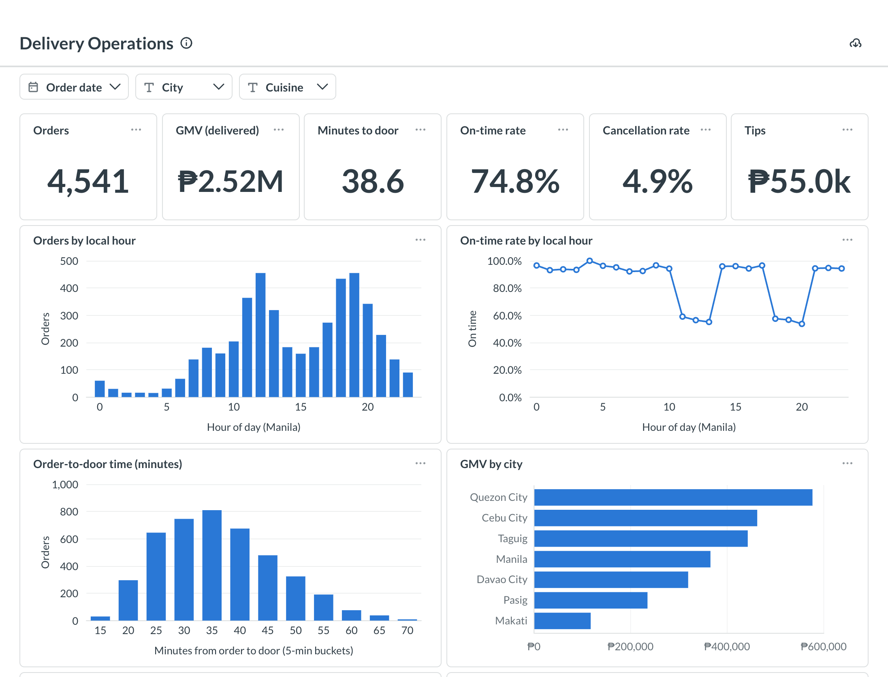
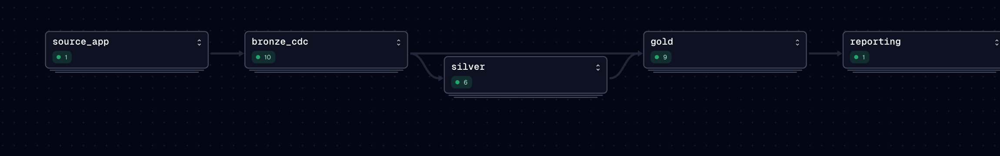
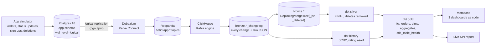
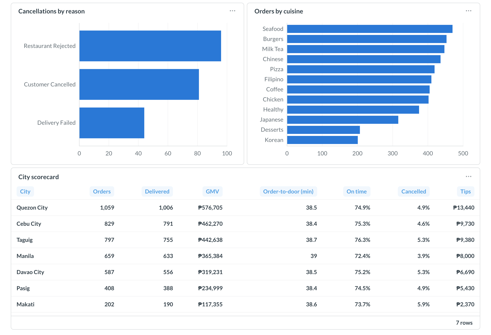
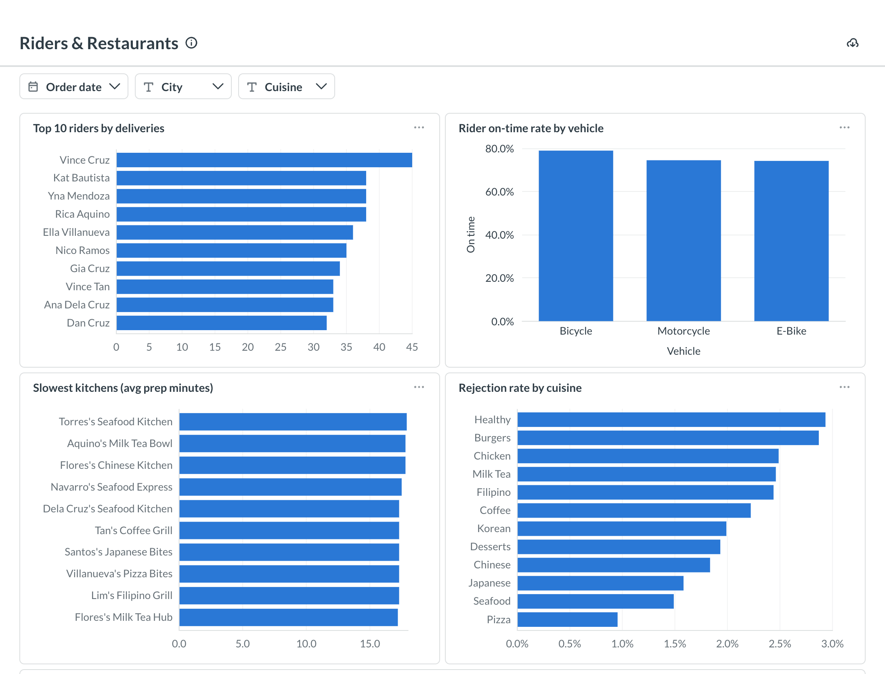
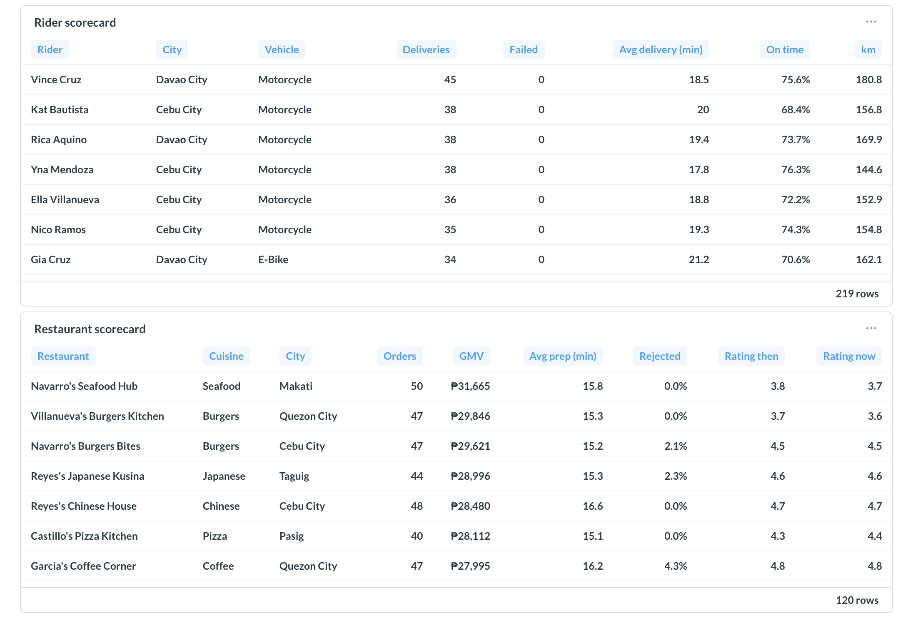
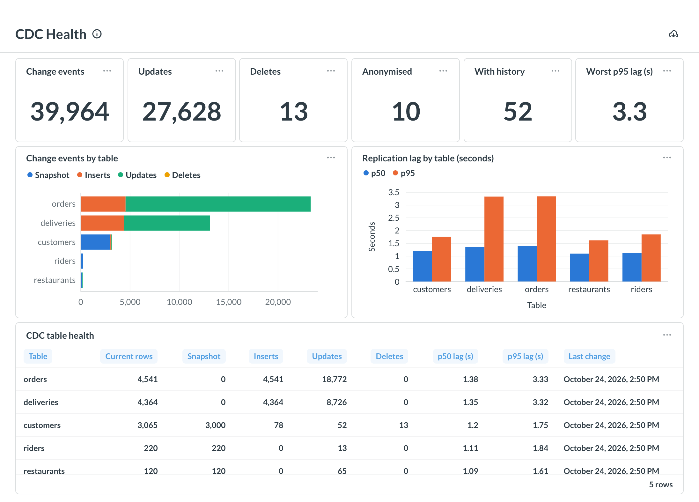
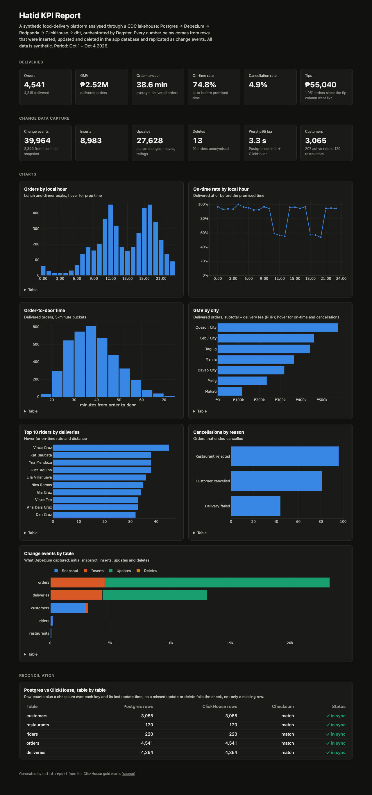

# Hatid: CDC Lakehouse on ClickHouse

[](https://github.com/almontemike2001-star/hatid-cdc-lakehouse/actions/workflows/ci.yml)

Change data capture for a synthetic food-delivery platform (*hatid* means "deliver" in Filipino).
The app database is Postgres. Every insert, update and delete is captured by **Debezium**,
streamed through **Redpanda** (Kafka) into **ClickHouse**, modeled with **dbt**, and orchestrated
by **Dagster**. The marts feed Metabase dashboards and a live KPI report.

**[View the live KPI report →](https://almontemike2001-star.github.io/hatid-cdc-lakehouse/kpi_report.html)**

All data is synthetic. It is generated by a seeded simulator in this repo.



---

## Why this project

My other portfolio projects cover batch ingestion ([BeanFlow](https://github.com/almontemike2001-star/retail-analytics-platform))
and append-only event streams ([PourStream](https://github.com/almontemike2001-star/pourstream-event-pipeline)).
Hatid covers what neither does: **replicating a database whose rows change and disappear**,
plus orchestration and CI for the dbt project.

| CDC problem | How Hatid handles it |
|---|---|
| An order row is updated 4–5 times as it moves from placed to delivered | Every version lands in an append-only changelog; current state is a `ReplacingMergeTree` keyed on the Postgres LSN, so the latest version always wins, even if events arrive out of order |
| Customers delete their accounts | Deletes arrive as change events with `_deleted = 1`; `FINAL` hides them from current state, and their past orders stay, anonymised (`ON DELETE SET NULL` in the source) |
| History is needed but the source only keeps the latest row | Type 2 customer history and point-in-time restaurant ratings are rebuilt from the changelog, with no snapshots |
| A column is added to the source while the pipeline runs | `hatid migrate-tips` adds `orders.tip_amount` live: ClickHouse first, then Postgres; the consumer pauses during the swap so no message is lost |
| Connector restarts replay events (at-least-once) | Changelog reads deduplicate on `(key, LSN)`; current state is idempotent by design |
| "Did everything arrive?" | Each run reconciles Postgres and ClickHouse with row counts **and** a checksum over every key and its last update time, so a missed update or delete fails the check |

## Architecture





| Layer | Tech | Notes |
|---|---|---|
| Source | PostgreSQL 16 | 5 tables, logical replication, `REPLICA IDENTITY FULL` so deletes carry the whole row |
| Capture | Debezium 2.7 (Kafka Connect) | Initial snapshot, then streaming; `ExtractNewRecordState` adds `op`, `lsn`, `source.ts_ms` |
| Transport | Redpanda (Kafka API) | One topic per table |
| Bronze | ClickHouse 24.8 | Kafka engine → materialized views → changelog `MergeTree` + current-state `ReplacingMergeTree` |
| Transform | dbt-core 1.12 + dbt-clickhouse | `FINAL` reads, ASOF join for point-in-time ratings, window functions for SCD2 |
| Orchestration | Dagster 1.13 + dagster-dbt | Asset graph from app activity to report; replication and every dbt test show up as asset checks |
| BI | Metabase v0.63 | 3 dashboards built through the API, filters for date, city and cuisine |
| CI | GitHub Actions | Spins up the whole stack, replays 2 days with a live schema change, reconciles, dbt **slim CI** on pull requests |

## Quickstart

Requires Docker and [uv](https://docs.astral.sh/uv/).

```bash
make up        # Postgres, Redpanda, Debezium, ClickHouse (healthy in about a minute)
make demo      # seed, register Debezium, simulate 3 days with a live schema change on day 2,
               # reconcile, dbt build, KPI report
make dagster   # Dagster UI on http://localhost:3003: materialize the hatid_pipeline job
make bi-up dashboards   # Metabase on http://localhost:3002 with the 3 dashboards
```

Other commands: `hatid simulate --hours 6`, `hatid reconcile`, `hatid migrate-tips`,
`hatid transform [dbt args]`, `hatid report`. `make reset` deletes all data.

## The bronze layer

Defined once in [`src/hatid/schema.py`](src/hatid/schema.py) and generated for every table:

```text
kafka_orders            Kafka engine: raw Debezium JSON from hatid.app.orders
   │ mv_orders_changelog
   ▼
orders_changelog        MergeTree: typed columns + _op, _lsn, _source_ts, _deleted, _raw
   │ mv_orders_current
   ▼
orders                  ReplacingMergeTree(_lsn, _deleted): SELECT ... FINAL = current state
```

Reading `bronze.orders FINAL` gives exactly the rows Postgres has now. The changelog keeps every
version with its raw JSON, so history can be modeled, and rows can be re-parsed after a schema change.

## Models

| Model | Grain | Notes |
|---|---|---|
| `silver.stg_*` | current row | `FINAL`, deleted rows removed; `tip_amount` selected only once the column exists |
| `silver.int_restaurant_rating_history` | rating version | Validity windows from the changelog |
| `gold.fct_orders` | order | Status, GMV, prep and delivery minutes, on-time flag, **rating in effect when ordered** (ASOF join) |
| `gold.dim_customers_history` | customer version | Type 2 history rebuilt from CDC, deletions flagged |
| `gold.dim_customers` / `dim_restaurants` / `dim_riders` | entity | Current state |
| `gold.agg_daily_city` | date × city | Orders, GMV, cancellations, delivery time, on-time rate |
| `gold.agg_rider_daily` | date × rider | Deliveries, failures, speed, on-time rate, km |
| `gold.agg_restaurant_performance` | restaurant | Prep time, rejections, rating then vs now |
| `gold.cdc_table_health` | source table | Snapshot / insert / update / delete counts and replication lag |

## Orchestration

[`orchestration/hatid_dagster/definitions.py`](orchestration/hatid_dagster/definitions.py) defines
the graph `app_activity → bronze_cdc → silver → gold → kpi_report`, scheduled every 30 minutes
(off by default). The bronze tables are filled continuously by Debezium, so `bronze_cdc` doesn't copy
data. It waits until ClickHouse has caught up with Postgres and records two asset checks per table:
`matches_postgres` (row count + checksum) and `replication_lag` (p95 under 30 s). dbt then runs only
on a consistent snapshot, and every dbt test appears as a Dagster asset check.

## Metabase dashboards

Built by [`bi/metabase/build_dashboards.py`](bi/metabase/build_dashboards.py) through the Metabase
API, on the ClickHouse gold database.

### Delivery Operations
Orders, GMV, order-to-door time, on-time rate, cancellations and tips by hour, city and cuisine.
On-time delivery falls from about 95% off-peak to under 60% at the lunch and dinner peaks.




### Riders & Restaurants



### CDC Health


The [live KPI report](https://almontemike2001-star.github.io/hatid-cdc-lakehouse/kpi_report.html)
shows the same story without Docker, including the Postgres vs ClickHouse reconciliation:



## Testing and CI

- **dbt (15 models, 34 data tests):** keys, accepted values, relationships, timestamps in order, deleted customers
  never current, SCD2 intervals never overlap, city GMV reconciles to the order fact.
- **Unit tests:** bronze DDL generation, type-specific JSON extraction, the order of steps in a live
  schema change, simulator lifecycle order, inactive riders never assigned, determinism.
- **Stack tests** (against the running containers): new activity replicates exactly, a Postgres DELETE
  removes the row from current state, an UPDATE creates a new version that wins, and Dagster runs the
  whole asset graph with every `matches_postgres` check passing.
- **CI** ([`ci.yml`](.github/workflows/ci.yml)): starts all four services, replays two simulated days
  with the schema change mid-run, reconciles, then on pull requests runs **dbt slim CI**: it builds `main`
  as a production stand-in and then only `state:modified+` with `--defer`.

## Sample run

| Metric | Value |
|---|---|
| Change events captured | 39,964 (3,340 snapshot, 8,983 inserts, 27,628 updates, 13 deletes) |
| Replication lag (p95, worst table) | 3.3 s from Postgres commit to ClickHouse |
| Orders / delivered | 4,541 / 4,319 |
| GMV (delivered) | ₱2.52M |
| Order-to-door / on-time | 38.6 min / 74.8% (56.5% at meal peaks vs 94.9% off-peak) |
| Tips since the column went live | ₱55,040 on 1,051 orders |
| Orders anonymised by account deletion | 10 |

## Project layout

```text
src/hatid/
  simulator.py      app workload: orders, status updates, sign-ups, deletions, rating drift
  schema.py         bronze DDL for every table, live schema-change steps
  cdc.py            connector registration, bootstrap, migration, reconciliation, lag
  report.py         static KPI report from the gold marts
  cli.py            `hatid` command
orchestration/hatid_dagster/definitions.py   Dagster assets, checks, job and schedule
dbt/                staging, intermediate, marts, singular tests (dbt-clickhouse)
infra/              Postgres schema, Debezium connector config
bi/metabase/        dashboards as code + screenshot script
tests/              unit and stack tests
docker-compose.yml  Postgres, Redpanda, Debezium, ClickHouse (+ Metabase profile)
```

## Trade-offs and next steps

- **`FINAL` at query time** is simple and always correct. At larger scale I'd run `OPTIMIZE` on a schedule
  or use `argMax` aggregations for hot dashboards.
- **JSON over Avro:** easy to inspect and replay. Production would use Avro with a schema registry,
  enforcing compatible schema changes.
- **One consumer per table** is enough here; higher-volume tables would get more partitions and
  `kafka_num_consumers`.
- **Next:** CDC for `TRUNCATE`, backfills by re-snapshotting a single table, and alerting from the Dagster
  asset checks.
